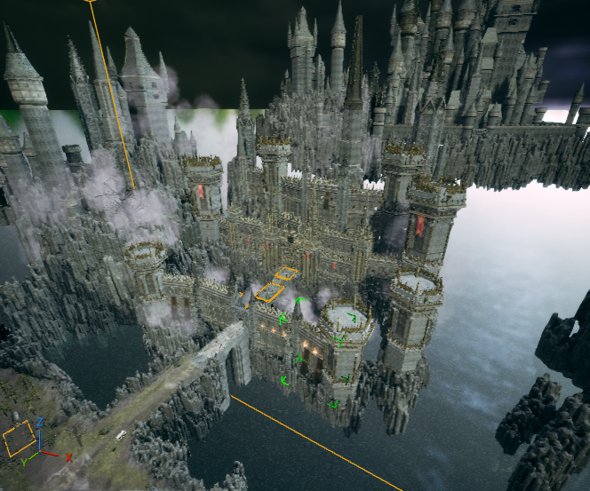
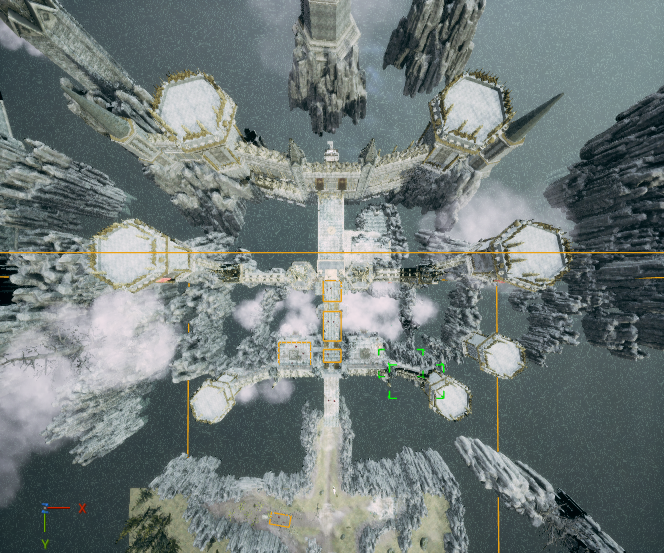
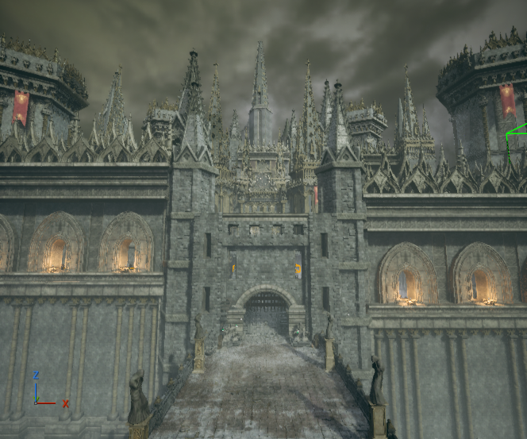
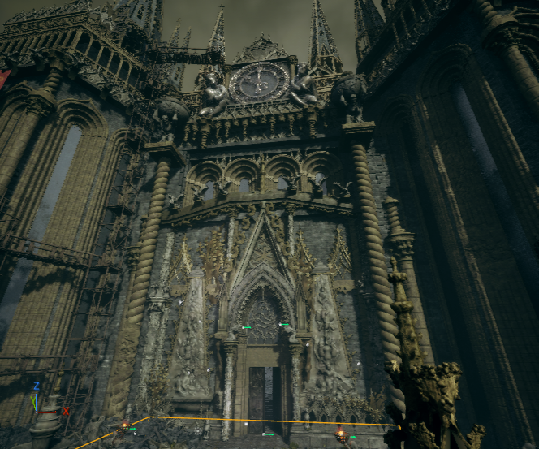
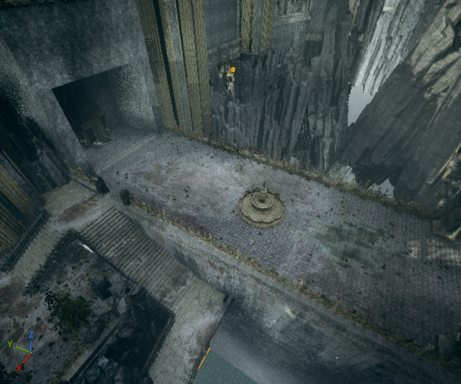
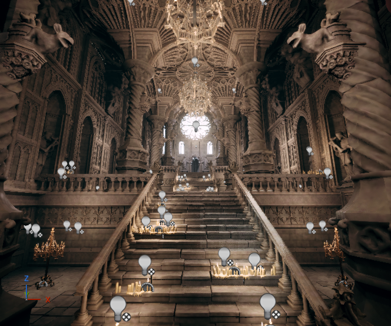

# Ashen Keep L0 — Dark Fantasy Castle reference audit

**Source map:** `/Game/DarkFantasyCastle_Small/Levels/MainLevel` · Unreal Engine 5.8.3 · FOTCodeX_SLF_583  
**Assembly data:** [AshenKeep_FantasyCastleAssemblies.json](AshenKeep_FantasyCastleAssemblies.json)

The strongest construction reference is the sequence of **bridge → outer portcullis → clock gate → raised fountain court → terraced hall**. Each threshold changes the scale of the space while keeping the next destination on the same sightline. Reserve **630 × 525 m** on the planned 1008 × 1008 m Landscape for a reference-scale Ashen Keep. Treat that reservation as a set of terraces and rock spurs around a cut for the bridge.

## Source and construction hierarchy

`MainLevel` was the current editor world. The pack also contains `Levels/Overview` and `Levels/LightVariations/NightLevel`, which were outside the audit. The live scene contained **10,778 actors**, including **10,013 StaticMeshActors** and **367 editor GroupActors**. The loaded scene had zero Level Instances and zero Packed Level Actors. PIE was off. The demo package reported clean after inspection and the viewport camera was returned to its starting pose.

Most exterior work sits directly in `Project/Meshes` (9,405 actors directly in that folder). The rear doorway has its own `Project/Meshes/EntryGate` folder. The hall is organized by floors, interior walls, stairs, railings and supports under `InteriorStructural`. Exterior and interior lighting have separate folders. The pack mixes large authored shell meshes with loose architectural parts. Sampled structure meshes are usually root StaticMeshComponents. The candle and chandelier Blueprints are examples of component-based dressing. Unreal MCP exposed the editor groups and actor/component attachments, but did not expose GroupActor membership. The assembly sets below identify actors by placement and function.

The approach comes from positive Y and runs toward negative Y around X = +101 m. The bridge cuts through the first wall, the clock gate marks the middle wall, and the rear portal leads into the hall. Giant tower shells define the flanks, with the smallest turrets and statues reserved for thresholds and deck edges. The distant castles and rock spires create a much larger skyline behind this route.

## Measurements

Dimensions are Unreal world-axis bounding boxes in metres (X × Y × Z). They include mesh extents, overlaps and decorative projections. Door opening, walking width, collision and navigability need separate validation. The JSON records exact actor paths, signed transforms, component mesh paths, material slots and bounds.

| Reference | Measured size or level | What the measurement covers |
| --- | --- | --- |
| Fortress shell | **585.48 × 460.88 × 308.43 m** | Seven `great_tower` shells, sixteen `great_wall` bays and the outer gate's low turret wall. World Z +160.73 to +469.16 m. |
| Fortress and great bridge | **585.48 × 472.33 × 366.09 m** | Primary structural envelope including the bridge shell. X −196.25 to +389.23 m, Y −270.34 to +201.99 m, Z +103.07 to +469.16 m. |
| With near silhouette pieces | **598.52 × 487.39 × 401.08 m** | Primary structure plus two neighboring big spires and one high wall fragment. Highest sampled near silhouette at Z +504.15 m. |
| Distant castle shells | **1,961.62 × 4,546.87 m** spread | Ten `bg_castle` copies. Highest distant shell at +1,313.50 m. These separate scenery pieces sit beyond the plateau reservation. |
| Great bridge shell | **46.58 × 241.80 × 133.87 m** | `great_bridge_1170`, including supports below the deck. The source mesh is 52.11 m wide and the placement narrows X to 0.894×. |
| Outer arch and portcullis | **35.33 × 6.57 × 30.67 m** | Arch and grille mesh envelopes. The grille itself is 10.13 m wide. Selected flanks and spires bring the gate sample to **56.65 × 15.86 × 72.31 m**. |
| Clock gate | **44.24 × 36.11 × 125.10 m** | Main shell plus recorded facade layers. The shell alone is 44.24 × 33.12 × 125.10 m. |
| Raised fountain court | **45.00 × 112.50 m** | Ninety contiguous structural slabs, six across by fifteen long. Top of this slab grid at +239.25 m. Smaller end extensions and surface paving are separate. |
| Crowned rear great tower | **109.04 × 98.35 × 192.80 m** | `great_tower_2` at 1.656× uniform scale and −15° yaw. The wider flank example reaches 121.82 m in world X. |
| Faceted roof tower sample | **25.81 × 22.16 × 120.93 m** | Three complete upper rings and the roof, Z +334.54 to +455.46 m. Lower faces continue into the wall below. |
| Rear entry facade | **43.49 × 14.26 × 62.73 m** | Mirrored facade details and the smaller door/frame set. The frame mesh at placement is about 4.62 m wide and 7.95 m high. |
| Hall floor field | **30.01 × 94.56 m** | All 88 floor-folder mesh actors, including the exterior extension behind the hall. Three central floor tops are +240.43, +244.93 and +249.43 m. |
| Axial hall stair flight | **6.00 × 9.17 × 4.60 m** | One flight of five step modules. Floor-to-floor rise is 4.50 m. A second flight repeats the arrangement. |

## How the kit goes together

**Walls and foundations.** `SM_Wall_01` includes the tall wall face, trim, columns and battlement profile. The local mesh is about **60 × 13.61 × 95.28 m**. The designer rotates and scales instances to fit tower lines. The east rear pair stacks two of the same bay with a 96.50 m Z offset and overlapping faces. Large, rotated `SM_Rock_01` placements below the outer wall bury the wall-to-rock seam. These overlaps explain why the structure reads as built into a cliff even though the major pieces are independent.

**Towers and crowns.** `SM_Castle_01` is a complete crowned shell, **55.69 × 46.56 × 116.43 m** locally. Placed great towers reach roughly 145–196 m in height with different scale and yaw. Smaller spires are built from `SM_SmallWall` faces with about 60° yaw steps and a separate `SM_Roof`. The three verified upper tiers on one turret reuse six faces per ring. At that placement, a **1.58 × 0.50 × 2.84 m** local wall face is scaled 8.13× and tiers step approximately 21.4–22.2 m. The outer bridge turrets use the same family at a smaller scale, with separate `SM_Top` bands. Broad open crowns, conical roofs and tiny finials establish distinct silhouettes at three distances.

**Entrances and ramparts.** At the outer wall the designer fitted `SM_CastleDoor` and `SM_PortCullis` independently, with different scale in each axis. The rampart wings repeat lit pointed niches behind a horizontal crown. At the clock gate, `SM_Entrance_02` provides the mass, `SM_EnteranceGate_01` the inset, and a mirrored pair of `SM_BigDoor_01` detail halves the frame. The clock, statues, base trims and finials are individually placed. The mirrored detail pair appears again at the rear portal, where an inset frame and two smaller leaves set the player-facing threshold.

**Bridge and raised court.** The main crossing uses `SM_GreatBridge` with a narrower inset `SM_Deco_05` base. A paver layer, paired statues and corner markers give the surface its own rhythm. Lower side flights around Y +69 to +76 m are independent **10.38 × 7.36 × 3.62 m** `SM_BrickStairs` placements. Between the clock gate and hall, the designer rotated `SM_Wall_05` onto its side. Its **7.5 × 2 × 7.5 m** local envelope becomes a 7.5 m square slab with 2 m structural thickness. Smaller 6 × 4 m-class pavers, perimeter dressing and a two-part fountain sit on top. Use the deck as a reference for a directed court with exposed edges and a destination. The 45 m width is a slab field dimension.

**Interior and stairs.** The hall uses two roughly **5 × 5 × 0.52 m** floor variants with a distinct exterior variant past the end gate. It combines **10.06 m** wall panels with roughly **10 × 10 m** ceiling bays and independent columns. The stair flights share the same axis, with their minimum-X mesh edges around X = +98.4 m. Each flight uses one half-length stair and four full stairs. The full `SM_Stairs_A_01` mesh is **6.00 × 2.18 × 1.10 m** locally and is placed every **2 m in Y and 1 m in Z**. The slight overlap covers the seam. The half module starts the run at half that pitch. Separate balusters, rail pieces and posts follow the stair and turn at landings. The hall sightline ties the flights to the bright end opening.

**Snap logic.** Use **7.5 m** for the court's structural grid, **5 m** for hall floors, **2 m horizontal / 1 m vertical** for the full hall stair pitch and **60°** for faceted turret sides. The nominal 60 m shell bay gives a wall planning span, while joins at towers use local rotation, scale and overlap. The 6 × 4 m-class surface pavers include rotated and slightly offset copies. These measured placements support several local grids and hand-fitted interfaces. The editor's global snap increment was outside the audit.

## Reuse shortlist

Actor IDs below are canonical editor object names. The [assembly catalog](AshenKeep_FantasyCastleAssemblies.json) gives source meshes, transforms, material slots and the scope of each measured union. Level Instances below are proposed project assets.

| Candidate | Verified anchors | Adaptation |
| --- | --- | --- |
| Great bridge | `great_bridge_1170`, `base_8`, `ground_tiles_Object78` | Reference the shell for scale and silhouette. Build abutments and playable surfaces as separate packages so the span can meet Astra's terrain. |
| Outer gate and turret pair | `StaticMeshActor_788`, `StaticMeshActor_794`, `gt_finished_Roof_lp5`, `gt_finished_Roof_lp5_387` | Rebuild the fixed flank kit as a project Level Instance with a pivot at the passage. Keep the grille independently addressable for gameplay. |
| Curtain wall and stacked facade | `great_wall8`, `great_wall5_515`, `great_wall13`, `great_wall13_796` | Reference the wall mesh. Generate repeated straight spans from the planned seam spacing. Hand fit tower returns and the terrain-facing lower tier. |
| Clock gate | `entrance_build_main_build_39`, `entrance_build_gate_33`, `clock_116` | Highest-value landmark assembly. Use a project Level Instance with a floor-line pivot, preserving the relative mirror and trim layers. |
| Fountain court | `ground_tiles_Object22_675` through `ground_tiles_Object22_764`, `StaticMeshActor_1077`, `StaticMeshActor_1081` | Lay out the 7.5 m substrate procedurally, trim the edges by hand, and place the fountain and walkable cover as independent actors. |
| Rear entry | `entrance_build_gate_806`, `SM_door_frame_272`, `SM_door2_804`, `SM_door2_854` | Put the fixed surround and frame in a small Level Instance. Fit door leaves to the required opening and collision. |
| Great tower and faceted spire | `great_tower_2`, `gt_finished_Tower_wall_lp278`–`295`, `gt_finished_Roof_lp10` | Reference the great tower shell. Make a project Level Instance for the repeated six-face tier and roof. Hand fit the base into the facade. |
| Hall and stair flights | `SM_Interior_Floor_Box46_73`, `SM_InteriorWall_A_783`, `SM_Stairs_A_01_4`, `SM_Stairs_A_711` | Build a hall bay on the 5 m grid and duplicate the measured stair flights as a separate Level Instance with the rails. |
| Rock transitions and ruins | `great_rock_490`, `great_rock_491`, `top_parts_broken_531`, `pillar_broken_444` | Reference the pack meshes and place them at specific junctions or worn edges. Keep clear footing through the main route. |
| Distant silhouette | `bg_towers_Object711`, `bg_towers_Object712`, `bg_castle4` | Reference distant architecture for atmosphere and scale. Keep it outside the main structural and traversal budget. |

## Visual quality and what carries over

- **Silhouette and layering.** The approach reveals successive wall lines. Each combines a broad base, a dense crown and a limited number of major vertical landmarks. Towers frame the route in pairs. The clock, fountain and hall end window make the centerline legible as the scale changes.
- **Repetition control.** The wall shell repeats at long range. Battlement and tower silhouettes change above it, and damage, banners, gargoyles, statues and torch bays vary the near view. Broken pavers, broken finials and the damaged column are separate meshes. The interior alternates floor variants on the same grid and repeats ceiling bays above landings.
- **Surface and seams.** The exterior samples share `MI_BrickWall_01`, `MI_Trim_03` and `MI_TopParts`; the great tower adds `MI_StoneBrick_01`. The outer arch overrides one slot with `MI_StoneBrick_01`. Inside, `MI_InBrickWall`, `MI_Trim_2_B` and the floor variants give the hall its own material cadence. Plinths, bands and buttresses conceal joints and give the larger masses readable depth. These materials and overlaps survive relighting.
- **Presentation in this map.** The main scene uses a movable directional light, a movable Skylight with the `TC_HDRI` specified cubemap, volumetric Exponential Height Fog, and two enabled Post Process Volumes. The unbound volume has manual exposure, bias +3 and a bloom override of 3. The other volume is bounded and has a manual exposure bias override of +2. The outdoor torch sample is set to 3500 K. Cool exterior fill, warm local light, visible mist and bright interior accents owe part of their appearance to that setup. Retain the hierarchy of lit thresholds and dark recesses when establishing Astra's own exposure and fog.
- **Capture limits.** These are six 664 × 553 editor viewport stills. Some volume outlines and light sprites remain visible. Dimensions are from actor and asset queries, and the screenshots serve as composition evidence. Collision, combat clearances and routes were outside this editor-only audit.

## Plateau and construction strategy for Astra

**Reserve 630 × 525 m as the minimum practical site envelope at reference scale.** The measured **585.48 × 472.33 m** fortress and bridge leave about **22 m per side in X** and **26 m per end in Y** if centered. Including the near spires leaves about **16 m and 19 m** respectively. Both reserve dimensions are multiples of 15 m, which fits two 7.5 m structural bays or three 5 m floor tiles. The far castle shells belong outside this reservation. Adjust the edge allowance to the actual slope and abutment sites once the Landscape is laid out.

1. Set Astra's local Z datum at the bridge-to-clock threshold, roughly +237 m in the demo. Set out the axis and gate positions before placing facade detail. Leave the bridge over a cut and locate the upper terraces where the large walls can bear into rock.
2. Place the main wall and tower shells as scale proxies. Establish the raised court and hall floor bands with their measured modules. Keep the narrowest passage and both stair landings editable until Astra's camera, collision and combat space are checked.
3. Package the clock gate, outer gate and hall stair as project Level Instances. Keep the repeating court substrate and straight wall runs parameterized. Hand fit tower corners, abutments, retaining faces and facade seams before adding ruins, practical lights and distant silhouettes.
