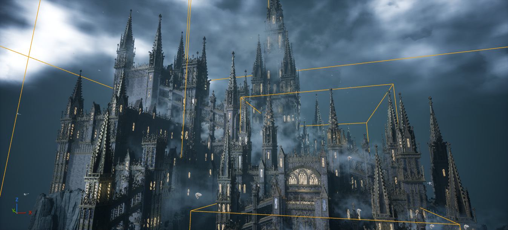
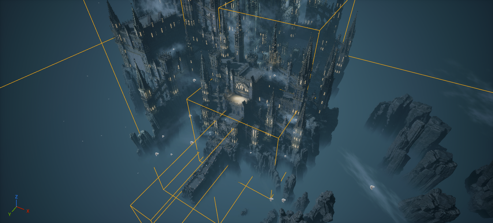
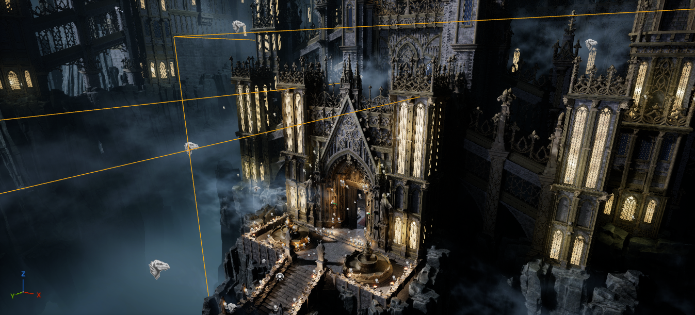
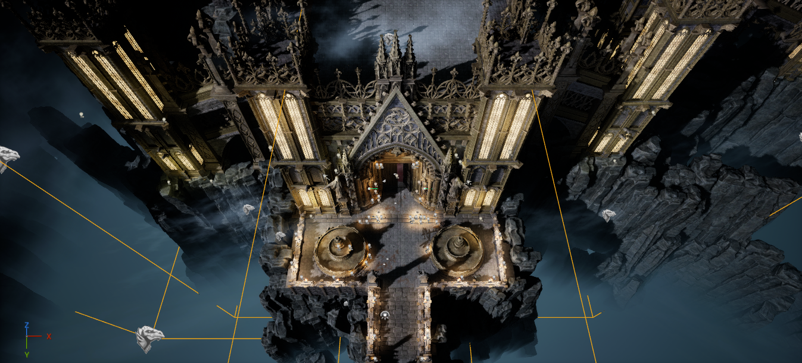
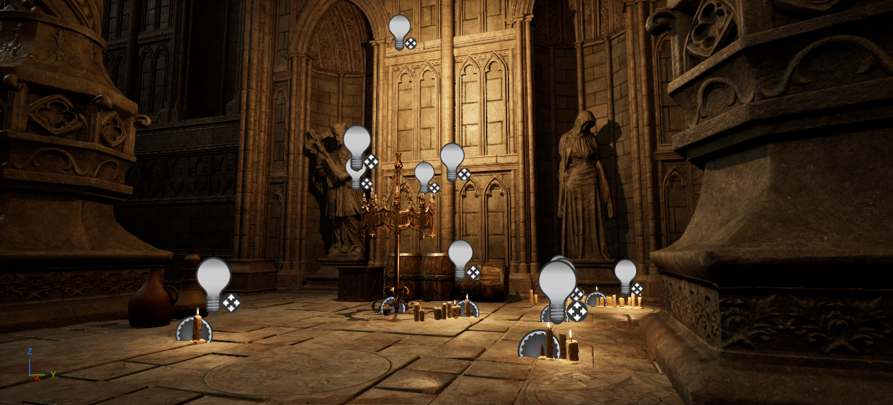

# Ashen Keep L0 — Gothic castle reference audit

**Source map** `/Game/Ft_Gothic_castle/Map/L_Map` · **Project** FOTCodeX_SLF_583 · **Method** live Unreal MCP inspection in the editor.

## Layout and scale

The demo presents a cliffside castle built in tiers. The most legible entrance sequence is the long, narrow stair approach, a wider paved court with paired fountains, and a pointed gate between two small towers. Past the façade, the sampled interior uses repeated pillar stations, vaulted pieces and separate floor levels. Secondary wings and towers rise behind and to either side. Cross-links and buttresses span gaps between masses, and a greatly enlarged rear tower rises above the smaller silhouettes.

| Measurement | Result | Interpretation |
| --- | --- | --- |
| Structural footprint | **271.06 × 309.50 m** in world X × Y | Includes approach stairs, outlying architectural towers, supports and bridges. X runs −204.47 to +66.59 m. Y runs −230.17 to +79.33 m. |
| Structural elevation | **−15.31 to +327.38 m**, 342.68 m of relief | Lowest approach stair wall to highest landmark tip. Includes foundations and roofs. The main gate actor origin is at Z +1 m. |
| Main entry forecourt paving | **30 × 15 m**, six by three nominal 5 m bays | The measured court is the open, fountain-lined landing on the approach side of the main gate. Paving overlaps the façade zone. Fixtures and edge geometry reduce clear play space. |
| Main gate Blueprint alone | **19.56 × 5.91 × 31.36 m** | Mesh assembly envelope. Door opening and depth of any playable gatehouse interior were not measured. |
| Gate with near flanking towers | **29.63 × 8.11 × 31.46 m** | Gate Blueprint plus the two closest matching tower Blueprints. |
| Sampled elevated deck | **23 × 30 m** at Z ≈ +37.4 m | Union of two editor-group bounds. Use as a terrace-sized reference. Roof, terrace and traversable courtyard use require route verification. |
| Architecture plus sampled rock scenery | **943.19 × 682.72 m** | Includes distant scenery. The rock envelope is useful for understanding the composition, while the architecture envelope is the basis for the plateau. |

Measurements are world axis-aligned unions of live editor actor bounds. The structural envelope covers 2,560 non-group actors in the architectural folders listed in the JSON. Adding the Deco folder leaves the extremal points unchanged. Rock, foliage and atmospheric elements are separate. Mesh measurements below use local asset bounds before instance scaling. All figures are approximate and report occupied envelopes. The audit does not establish collision, navigable widths or support contact footprints.

## Construction methods

| System | Observed construction and useful dimensions |
| --- | --- |
| Walls and foundations | A wall sample uses `SM_Wall_06` at the base, `SM_Wall_05` as the repeating infill and `SM_Wall_04` as the wider ornate crown. Their local X spans are 7.54, 7.50 and 7.59 m. The plain panel is 2 m thick and 7.5 m high. Placed samples repeat in both horizontal bay and vertical story increments of **7.5 m**, with small transverse offsets where the profile changes. Rock meshes mask the transition to the cliff. Dedicated long pillars, support towers and wall brackets give overhangs visible bearings. |
| Towers and battlements | The round tower separates shaft and roof. A buttressed Blueprint adds repeated paired support meshes. Square towers stack base, two intermediate mesh families, crown and trim, with roof variants. Smaller towers and ornate crown pieces break the parapet line. The highest landmark is a scaled tower Blueprint, even though its actor object name starts with `SM_`. |
| Gatehouses | The main gate combines `SM_Castle_Gate_01` and `SM_Castle_Gate_01_top` in a Blueprint, with separate nearby flanking towers. The secondary portal is a single `SM_Castle_Gate_02` mesh. Surrounding wall returns, stairs and landing should be treated as separate interfaces. |
| Courtyards and rooms | Exterior and interior floor modules are nominally **5 × 5 m** and ~0.52 m thick. Entry paving uses 5 m increments and two sampled pivot levels at Z +0.5 and +1 m. In the interior, `Interior_Big_Pillar_01` combines foot, repeated shafts, gargoyle and capital. Two observed pillar rows are **10 m apart** with **10 m longitudinal stations**. Interior wall samples use a 10 m pitch and a panel ~10.06 × 0.61 × 4.53 m. `SM_ceiling_A_02` provides a vaulted module around 5.09 × 10.15 × 9.92 m in its local axes. |
| Stairs and landings | The first entrance flight uses four `SM_Stairs_B_01` placements with **2 m horizontal and 1 m vertical** pivot steps. Separate left/right `SM_Ex_Stair_Wall` segments continue the stone profile below the steps. A flight with its side walls occupies ~6.60 × 8.27 × 8.51 m, with the height including supports. The interior `SM_Stairs_A_01` mesh is ~6 × 2.18 × 1.10 m. A sampled interior rail repeats every **0.50 m** horizontally and **0.25 m** vertically. The demo also has a dedicated StairBlocker folder. |
| Bridges, walkways and ramparts | The large and small side-bridge meshes occupy ~26.96 × 7.77 × 40 m and ~17.47 × 5.19 × 28 m. Their Z extents describe the full architectural structure. Measure end seams and usable deck width before treating the whole envelope as a traversal surface. Floors, side rails, wall crowns and supports are separate categories in the Outliner, allowing the walkable surface and silhouette to be fitted independently. |
| Decoration and ruins | Pointed tracery, tall window bands, gargoyles and statues establish repeated accents. Ivy and leakage decals add localized weathering. Wood dressing and freestanding props sit around otherwise regular stone bays. Broken cliff edges and projecting masonry contribute much of the ruin silhouette. The audit did not establish a standalone ruin prefab. |

The measured repeats support a **50 cm planning subgrid** for whole-bay layout. Use 5, 7.5 and 10 m increments for paving, exterior walls and interior bays. Some pivots have custom offsets and a sampled stair is yawed 70°. Fit transitions from verified connection points and inspect seams in viewport. The editor's active snap settings were not measured.

## Reusable assemblies

The live Outliner query found 4,581 actors, 97 native editor GroupActors and zero loaded Level Instance actors. The map uses loose mesh placements and component-based Blueprints alongside editor grouping. Names below are exact actor object names. Full object paths, measured bounds, source meshes and sampled component transforms are in [AshenKeep_GothicCastleAssemblies.json](AshenKeep_GothicCastleAssemblies.json).

| Candidate | Live form and approximate X × Y × Z | Adaptation |
| --- | --- | --- |
| Main entrance `SM_Castle_Gate_01_42` with `BP_Small_Tower_2` and `BP_Small_Tower_5` | Three Blueprint actors, 29.63 × 8.11 × 31.46 m combined | Reference the pack assets, then assemble an Ashen Keep Level Instance for the static shell. Keep interaction and progression in the Ashen Keep map or gameplay Blueprint. |
| Main forecourt `SM_Exterior_Floor_2668` and adjoining tiles | Loose collection, 30 × 15 m paving | Rebuild as a 5 m tile grid. Preserve a clear central route and place fountains or other landmarks in the side bays. |
| First approach flight `SM_Stairs_A_27`–`SM_Stairs_A_30` plus eight cheek-wall pieces | Loose collection, 6.60 × 8.27 × 8.51 m | Duplicate one measured flight into a project-owned Level Instance. Use the same rise/run for repeats, with authored landings at route turns. |
| Curtain wall around `SM_Wall_8`, `SM_Wall_9`, `SM_Wall_22`, `SM_Wall_10` and `SM_Wall_11` | Loose placements, sampled union 3.74 × 15.08 × 30.19 m | Generate straight runs from the bay and story grid. Author corners, gates, wall ends and crown transitions by hand. |
| Small and tall square towers `BP_Small_Tower_3`, `BP_Big_Tower_1` | Blueprints, 8.27 × 8.30 × 31.25 m and 12.02 × 12.01 × 58.79 m | Reference the pack Blueprint variants. Fit floors and ramparts to measured interfaces. |
| Round and buttressed towers `BP_Round_Tower2`, `BP_Round_Tower4` | Blueprints, 14.03 × 12.57 × 100.29 m and 15.60 × 12.57 × 100.29 m | Reference the existing Blueprints where the tower height and support geometry fit. Use the buttressed variant at a major wall junction. |
| Skyline landmark `SM_CastleTower_12` | `BP_Tall_Tower01` instance, 28.84 × 29.52 × 219.67 m | Reference its tiering and taper. Decide the actual playable height from floor spacing and route length before adapting this scaled placement. |
| Secondary portal `SM_Castle_Gate_2` | Static mesh actor, 21.17 × 2.04 × 21.07 m | Reference the mesh as a facade. Author returns, threshold and gameplay gate separately. |
| Cross-links `SM_CastleSideBridge_2`, `SM_CastleSideBridge_5` | Static mesh actors, 26.96 × 7.77 × 40 m and 17.47 × 5.19 × 28 m | Reference the mesh directly and fit custom end abutments. Validate the deck and guardrails at player scale. |
| Interior pillar stations around `SM_Pillar_set_2_Object006sdf001_2` | Repeated pillar Blueprints, sampled union 12.96 × 22.95 × 16.56 m | Reuse the pillar Blueprint at 10 m stations and fit floors, stairs and vaults to the required room. |
| Elevated deck `GroupActor_63` and `GroupActor_64` | Two editor groups, 23 × 30 × 0.52 m combined | Reference the measured deck size and recreate the layout from floor modules. Editor group membership was not extracted. |

## Visual composition

- **Silhouette and hierarchy.** The low stair and entrance lead into layered wall masses, small spires, taller secondary towers and one dominant upper landmark. Bridges reveal gaps between volumes. Use setback and elevation changes to keep the massing readable from the approach and across the ravine.
- **Repetition and transitions.** Long plain stone bays make the ornament legible. Crown pieces, stacked window bands and clustered gargoyles concentrate detail around edges and thresholds. Distinct base, infill and top profiles make tier changes look built. Side walls and buttresses carry that visual logic through the stairs and bridges.
- **Surface palette.** Live mesh material slots resolve to pack instances including `MI_ExBrickWall`, `MI_InBrickWall`, `MI_Trim_2_A`, `MI_Ornamental_2`, `MI_RoofTilesTS` and `MI_WG_Yellow`. The palette separates masonry field, ornament, roof and glazing, and the JSON records sampled slot assignments and component overrides. Leakage decals, ivy and localized props can be placed as a separate dressing pass.
- **Atmosphere and lighting.** Cold fog separates elevations and distant volumes. Warm window accents and pools of light make the gate and interior alcoves readable. The map contains a directional light, skylight, exponential height fog, 42 actors in FogSheets, 144 in PointLights and 54 in Spotlights. Five enabled, bounded post-process volumes use priorities 1–4. The silhouettes, apertures, masonry profiles and prop placement transfer with the architecture. The blue atmospheric separation, amber contrast and exposure balance should be tuned in Ashen Keep's lighting.

## Viewport evidence

Editor captures include volume outlines and light icons. The overview is framed on the castle body and approach, with the tallest tips partly outside the frame.

## Astra handoff

Reserve a **300 × 340 m usable castle plateau** within the planned **1008 × 1008 m Landscape** for a reference-scale build. Centering the structural envelope inside that rectangle leaves about **14.5 m on each X side and 15.3 m on each Y side** for edge treatment, route connections and the first terrain tie-ins. These are planning allowances. Keep major cliff slopes, distant rock scenery and any extended arrival route outside the usable plateau allocation. The shelf can be terraced where the route needs an elevation change.

1. Block out the entrance stair, 30 × 15 m forecourt, gate threshold, interior route and exit toward the upper keep. Establish floor elevations and test player traversal before laying out the skyline.
2. Set the walls and decks with the measured module pitches. Reuse tower and portal Blueprints as reference units. Fit supports at cliff edges and bridge ends after the route and terrain datums are fixed.
3. Package the gate frontage and repeatable stair flights as Ashen Keep Level Instances once the joins and collision are verified. Generate regular wall and paving runs from the measured grid. Keep the landmark and all route-critical junctions hand-authored.
4. Tune camera sightlines at the approach, courtyard and upper arrival. Apply dressing and rebuild fog and local light around those views after the geometry reads at gameplay exposure.

The audit used read-only Unreal queries and viewport captures. Its deliverables are documentation, structured references and screenshot evidence.
